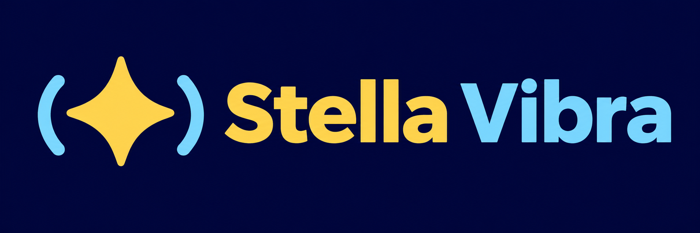

# Stella Vibra

  

**Lua-powered haptic effects for flight simulators on Windows.**

Stella Vibra connects simulator telemetry to supported WINCTRL vibration motors. Edit effects, tune their parameters while flying, and route each effect to the motors you want.

**Version 0.2.1** adds Explorer file management and New File path selection. This local build has no release tag or published release. The project owner confirmed Explorer name sorting; other GUI acceptance checks remain pending. MSFS 2024 takeoff and landing vibration was confirmed by the project owner with an earlier build. Other game integrations have not been verified in live sessions.

[User manual](docs/MANUAL.md) · [0.2.0 release notes](docs/RELEASE-NOTES-0.2.0.md) · [Third-party notices](docs/THIRD-PARTY-NOTICES.md)

## What it does

- Creates portable projects containing Lua effects and saved parameters.
- Connects to the selected simulator and discovers supported HID devices automatically.
- Provides a tabbed script editor, live parameter controls, effect toggles, motor monitor, telemetry inspector, and debug output.
- Creates folders and example Lua scripts from the Explorer context menu, and preserves effect settings when renaming or dragging them to another effects folder. The Explorer keeps names sorted. File → New File shows a selectable effects root and accepts script paths with or without the `effects/` prefix, creating missing folders as needed.
- Supports script defaults, project-wide settings, and per-aircraft overrides.
- Routes named effect outputs to logical slots and then to physical motors.
- Produces constant or PWM vibration, with a single winning request per motor.

## Games

| Game | Connection | Included effects | Verification |
| --- | --- | --- | --- |
| Microsoft Flight Simulator 2024 | SimConnect | 11: ground, aerodynamics, engines | Takeoff/landing vibration reported working by the project owner; final package checks pending |
| Microsoft Flight Simulator 2020 | Separate SimConnect client | 11 | Live verification pending |
| X-Plane 12 | Local UDP RREF | 11 | Live verification pending |
| War Thunder | Local HTTP telemetry | 8 | Live verification pending |
| DCS | Local UDP exporter | None yet; telemetry and script setup only | Automatic profile discovery confirmed; installation and live reception pending |

One project targets one game. DCS projects now receive native telemetry through a dedicated exporter. Settings → Set DCS Telemetry automatically discovers profiles and offers Add Scripts, Update Scripts, Restore Scripts and Remove Scripts. It edits only Stella-related lines in the current Export.lua; restoration of modified scripts requires confirmation. The default interval is 50 ms (10–100 ms); edits to the number in config.lua are read back by the dialog. Restart DCS after changes. Remove Scripts also removes Export.lua when no bytes remain. DCS default effects are not included yet.

## Devices and requirements

- Windows 10/11, x64, with a writable application folder.
- A supported WINCTRL device with a compatible vibration output interface. The implemented device list includes URSA MINOR Airbus, Combat/Fighter and Space sticks (left/right), URSA MINOR throttles, Combat Throttle Metal.EX, and Orion II stick/throttle bases. See the [device table](docs/MANUAL.md#devices-and-routing) for exact product IDs.
- A simulator running on the same PC. Remote simulator connections and generic joystick force feedback are not supported.

The logical categories Yoke, Stick, Throttle, Pedal and Wheel are routing labels; they do not imply support for every device in those categories.

## Getting started

1. Keep the entire portable application folder together and run `StellaVibra.exe` at its root.
2. Select **File → New Project**, choose a directory and target game, and enable **Generate default Lua scripts**.
3. Review **Settings → Set Channels...** and each effect's **Outputs**. Review physical assignments in **Motor Monitor → Slots**.
4. Select **Stop All** while checking your configuration. Start the simulator and enter a flight; watch the status bar and Telemetry view.
5. Select **Resume All** when ready. Start with low Power values and enable the effects you want.
6. Parameter changes apply immediately. Save a script to activate code edits; use **Save** or **Save All** to persist your work.

Execution is normally enabled: an open project can produce vibration when fresh flight telemetry and matching motors are available. Merely opening a window or connecting hardware does not create a vibration request. See the [manual](docs/MANUAL.md) before your first session.

## Portable files

Settings live in `StellaVibra.pref` beside the root executable. No application preferences are written to the registry or AppData. The last project reopens if it still exists. Different application folders have independent preferences.

`bin/` contains the application and runtime libraries; `effects/` contains templates; `docs/` contains offline help. Keep `assets/`, `licenses/`, and `sources/` with the package as well. User projects can be stored elsewhere. **Help → README** and **Help → User Manual** work offline; F1 opens the manual.

## Release and licensing status

Stella Vibra's code is licensed under [MIT](LICENSE). Qt, Lua, referenced Aurora Vibra code, Microsoft runtimes, and SimConnect have their own notices and terms.

The Windows package includes unmodified Microsoft SimConnect SDK client DLLs for MSFS connectivity. These components remain the property of Microsoft Corporation and its licensors and are not covered by Stella Vibra's MIT license. Microsoft license terms and third-party notices accompany the package. Stella Vibra is not endorsed or supported by Microsoft. See the [third-party notices](docs/THIRD-PARTY-NOTICES.md) for the distribution policy and [release notes](docs/RELEASE-NOTES-0.2.0.md) for verification status.

## Troubleshooting and reporting

Check Debug Output and the `diagnostics/` folder. When reporting a problem, include the app version, game and aircraft, device model, steps to reproduce, and relevant logs. For a crash, preserve the matching `bin/StellaVibra.exe`, `bin/StellaVibra.pdb`, and any dump before updating. Logs and dumps can contain local paths and session data; review them before sharing. Nothing is uploaded automatically.

See the [manual](docs/MANUAL.md) for project saving, mappings, Lua authoring, and troubleshooting.
